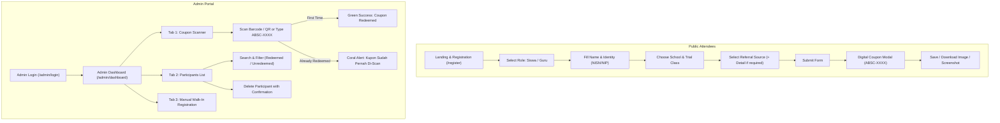

# Product Requirements Document (PRD) - Frontend Web Application
**Project:** Absence Registration & Coupon Redemption System (Sistem Registrasi & Penukaran Kupon)  
**Target Users:** Students (Siswa), Accompanying Teachers (Guru Pendamping), and Event Committee Admins  
**Tech Stack Recommended:** React / Vue / Nuxt / Next.js with Tailwind CSS, Lucide Icons, HTML5 Barcode/QR Scanner, Canvas-to-Image / HTML2Canvas  
**Backend API Base URL:** `/api` (RESTful JSON, Laravel 13 + PostgreSQL + Laravel Sanctum)  
**Design Compatibility:** Prepared for **Google Stitch Design** / AI Prompt-to-UI Generators / Figma  

---

## 1. Executive Summary & Design Philosophy

### 1.1. Context
This web application is the client-facing interface for an educational trial class & open house event. It serves two distinct audiences:
1. **Public Attendees (Students & Teachers):** High-converting, friendly, mobile-first registration portal. Must be effortless on smartphones, accessible across slow mobile connections, and zero-confusion for teenage students and senior teachers.
2. **Event Organizers & Admins:** Lightning-fast, reliable scanner and attendance control dashboard capable of scanning hundreds of attendee coupons without delay or errors.

### 1.2. Design Principles
- **No Confusion (Zero Friction):** Single-column layout on mobile, progressive disclosure of conditional fields, self-explanatory card selectors for Role and Trial Class, and friendly Bahasa Indonesia copy.
- **Instant Gratification:** Instant coupon display with prominent barcode/QR code and 1-tap "Simpan Kupon ke Galeri / Download" so students never lose their coupon ticket.
- **Clarity & High Contrast:** Soft pastel surfaces paired with high-contrast text (`#1E2238`) and unambiguous visual feedback states (success in soft mint, alerts in coral red).
- **Stitch Design Ready:** Standardized design tokens, layout trees, component hierarchies, and ready-to-use prompts for Google Stitch.

---

## 2. Design System & Style Tokens (Google Stitch Spec)

### 2.1. Mandatory Color Palette
| Token Name | Hex Code | Semantic Role | Usage Description |
|---|---|---|---|
| `--color-primary` | `#9FA0FF` | Primary Brand / Action | Active states, primary CTA buttons, focused borders, hero badges, icon accents |
| `--color-mint` | `#D5E8E6` | Secondary / Success Canvas | Success notification cards, redeemed badges, secondary soft panels, ticket headers |
| `--color-warm` | `#FFF3E3` | Canvas / Warm Background | App page background canvas, card highlights, warm informational banners |
| `--color-coral` | `#FF7171` | Alert / Danger / Highlight | Error validation messages, double-scan warning banners, delete actions, urgent pills |

#### Neutrals & Complementary Tokens
| Token Name | Hex Code | Semantic Role | Usage Description |
|---|---|---|---|
| `--color-surface` | `#FFFFFF` | Card & Modal Surface | Elevated containers, form input backgrounds, dialog cards |
| `--color-text-main` | `#1A1D2E` | Deep Slate / Headline | Page headings, form input text, table contents (WCAG AAA contrast) |
| `--color-text-muted` | `#64748B` | Secondary Body Text | Placeholders, help labels, subtitles, timestamp strings |
| `--color-border` | `#E2E8F0` | Subtle Dividing Lines | Input outlines, table cell borders, divider lines |
| `--color-primary-dark`| `#7B7CE6` | Primary Hover State | Hover and active tap state for `#9FA0FF` buttons |
| `--color-coral-dark`  | `#E05353` | Coral Hover State | Hover state for destructive buttons |

### 2.2. Typography System
- **Primary Font Family:** `Plus Jakarta Sans`, `Inter`, or `system-ui, -apple-system, sans-serif`
- **Monospace Font (Coupons & IDs):** `JetBrains Mono`, `Roboto Mono`, or `monospace`
- **Type Scale:**
  - `Display / Hero`: 32px / 38px line-height, Bold (700)
  - `Title 1 / Page Header`: 24px / 32px line-height, SemiBold (600)
  - `Title 2 / Card Header`: 18px / 26px line-height, SemiBold (600)
  - `Body Regular`: 15px / 22px line-height, Regular (400)
  - `Body Medium / Button`: 15px / 22px line-height, Medium (500)
  - `Small / Helper / Badge`: 13px / 18px line-height, Regular (400) or Medium (500)
  - `Code / Coupon`: 20px / 24px line-height, ExtraBold (800) Monospace

### 2.3. Radii, Shadows & Spacing
- **Border Radius:**
  - Buttons & Inputs: `12px` (`rounded-xl`)
  - Content Cards & Modals: `20px` (`rounded-2xl` to `rounded-3xl`)
  - Badges & Pills: `9999px` (`rounded-full`)
- **Elevation / Shadows:**
  - Card Subtle: `0 4px 20px -2px rgba(159, 160, 255, 0.12), 0 2px 6px -1px rgba(0, 0, 0, 0.04)`
  - Floating Action / Modal: `0 20px 40px -10px rgba(26, 29, 46, 0.15)`
  - Primary Button Glow: `0 4px 14px 0 rgba(159, 160, 255, 0.39)`
- **Touch Target Accessibility:** All clickable buttons, pills, and dropdowns have a minimum height of `48px` to facilitate error-free mobile tapping for all ages.

---

## 3. Information Architecture & User Flows



---

## 4. Screen-by-Screen Detailed Specifications

---

### Screen 4.1: Public Registration Page (`/register` or `/`)

#### 4.1.1. Goal & Audience
A single-page, welcoming registration form designed for high completion rates on mobile devices by teenagers (14-18) and teachers (25-60).

#### 4.1.2. Layout Structure
- **Canvas Background:** Soft Warm Cream (`#FFF3E3`).
- **Header Section:**
  - Event Mascot / Friendly Illustration or School Logo.
  - Title: *"Pendaftaran Trial Class & Open House"*
  - Subtitle: *"Isi formulir singkat di bawah ini dan dapatkan kupon voucher eksklusif kamu!"*
- **Main Form Card:** Centered white container (`#FFFFFF`), `max-w-lg`, `rounded-2xl`, with soft primary shadow.

#### 4.1.3. Component Specifications & Interactive States

##### A. Role Selector (`role`)
- **UX Pattern:** Two large selectable cards side-by-side (radio group).
- **Options:**
  - Card 1: **Siswa** (Icon: Graduation Cap / Backpack) — *"Saya seorang pelajar/siswa"*
  - Card 2: **Guru Pendamping** (Icon: Badge / Briefcase) — *"Saya guru yang mendampingi"*
- **State Styling:**
  - Unselected: White background, subtle border `#E2E8F0`, muted text.
  - Selected: Border 2px `#9FA0FF`, light background tint `#9FA0FF15`, icon colored `#9FA0FF`, checkmark badge in upper right.

##### B. Personal Information
- **Nama Lengkap (`name`):**
  - Label: *"Nama Lengkap"*
  - Placeholder: *"Contoh: Ahmad Rizky Pratama"*
  - Helper Text: *"Gunakan nama asli untuk verifikasi kehadiran."*
- **Nomor Identitas (`identity_number`):**
  - Label changes dynamically based on role:
    - If Siswa: *"Nomor Induk Siswa Nasional (NISN)"* — Placeholder: *"10 digit NISN kamu"*
    - If Guru Pendamping: *"Nomor Induk Pegawai (NIP / NUPTK)"* — Placeholder: *"NIP atau identitas guru"*
  - Helper Text: *"Bisa menggunakan nomor identitas sekolah jika belum memiliki NISN/NIP."*

##### C. Asal Sekolah (`school_id`)
- **UX Pattern:** Searchable searchable combobox / select dropdown populated from `GET /api/schools`.
- **Label:** *"Asal Sekolah"*
- **Features:**
  - Live filtering as the user types school name.
  - Placeholder: *"Pilih atau cari nama sekolah kamu..."*
  - Loading skeleton state while fetching schools from API.

##### D. Pilihan Trial Class (`trial_class`)
- **UX Pattern:** 2x2 interactive grid of visual cards.
- **Options:**
  1. **IT (Information Technology):** Icon: Laptop/Code. Tagline: *"Web & App Development"*
  2. **DKV (Desain Komunikasi Visual):** Icon: Palette/Pen Tool. Tagline: *"Desain Grafis & Multimedia"*
  3. **KULINER:** Icon: Chef Hat/Utensils. Tagline: *"Tata Boga & Seni Kuliner"*
  4. **MOBILE_LEGENDS:** Icon: Gamepad/Trophy. Tagline: *"Esports & Game Strategy"*
- **State Styling:** Active card highlighted with `#9FA0FF` border and soft `#D5E8E6` tag badge.

##### E. Informasi Referral (`referral_source` & `referral_detail`)
- **Sumber Informasi (`referral_source`):**
  - Dropdown options: `Medsos`, `Banner`, `Event`, `Teman`, `Guru`, `Website`, `Lainnya`.
- **Detail Sumber (`referral_detail`):**
  - **Dynamic Visibility:** Appears smoothly with slide-down animation **ONLY** when `referral_source` equals `Medsos`, `Banner`, or `Event` (matching backend rule `required_if:referral_source,Medsos,Banner,Event`).
  - Label dynamically adjusts:
    - If `Medsos`: *"Akun Medsos / Platform (Contoh: Instagram @sekolah, TikTok, dll)"*
    - If `Banner`: *"Lokasi Spanduk / Banner (Contoh: Depan Gerbang Sekolah, Lampu Merah)"*
    - If `Event`: *"Nama Acara / Lokasi Kunjungan"*

##### F. Submit CTA Button
- **Label:** *"Daftar Sekarang & Ambil Kupon"*
- **Style:** Full-width, 52px height, bold font, background `#9FA0FF`, text white, hover `#7B7CE6`, active scale 0.98.
- **Loading State:** Spinner with label *"Menyiapkan Kupon Kamu..."*, button disabled.

---

### Screen 4.2: Digital Coupon Pass Modal / Success View

#### 4.2.1. Goal & Audience
Instantly shows the generated coupon code (`ABSC-XXXX`) upon successful `201 Created` API response. Must be immediately saveable/screenshot-ready so attendees don't panic or lose it.

#### 4.2.2. Visual Ticket Anatomy (Stitch Card Spec)
- **Container:** Stylized boarding-pass / perforated ticket card (`#FFFFFF`) with dashed tear-line and semicircular notches on left & right.
- **Header:** Mint Green accent background (`#D5E8E6`).
  - Event title & status: *"Kupon Pendaftaran Terverifikasi"*
  - Badge: Role (`Siswa` or `Guru Pendamping`) & Trial Class pill.
- **Main Code Section:**
  - Large Monospace Coupon Code: e.g. `ABSC-0001` in 28px bold, colored `#1A1D2E`.
  - Copy to Clipboard button (with "Tersalin!" tooltip).
  - Rendered **Barcode (CODE128) & QR Code** generated on client-side from the `coupon_code` string.
- **Attendee Details Grid:**
  - Nama: *Ahmad Rizky*
  - Identitas: *0067891234*
  - Asal Sekolah: *SMK Negeri 1 Jakarta*
  - Trial Class: *DKV*
- **Action Buttons:**
  - **Primary Action:** *"Simpan Kupon / Unduh Gambar"* (Trigger HTML5 canvas export to JPG/PNG, button colored `#9FA0FF`).
  - **Secondary Action:** *"Tutup & Selesai"* (Ghost button).
  - **Helper Notice:** Small box in warm cream (`#FFF3E3`) with coral alert text: *"⚠️ Harap simpan atau screenshot kupon ini untuk ditunjukkan kepada panitia di lokasi acara."*

---

### Screen 4.3: Admin Login Page (`/admin/login`)

#### 4.3.1. Goal & Audience
Fast, distraction-free authentication for event committee administrators.

#### 4.3.2. Layout & Form Elements
- **Canvas:** Minimalist centered layout on `#FFF3E3`.
- **Card:** `#FFFFFF`, `rounded-2xl`, shadow.
- **Title:** *"Portal Admin & Scanner Kupon"*
- **Form Fields:**
  - Username: Text input, autofocus, clear button.
  - Password: Password input with visibility toggle (Eye icon).
- **Submit Button:** Background `#9FA0FF`, label: *"Masuk ke Dashboard"*.
- **Error State:** Coral Red (`#FF7171`) inline callout banner: *"Username atau password salah. Silakan coba lagi."*

---

### Screen 4.4: Admin Dashboard & Scanner Portal (`/admin/dashboard`)

#### 4.4.1. Navigation & App Bar
- **Top Bar:**
  - Left: Logo + *"Absence Event Control"*.
  - Center: Status pill showing Active Camera / Ready status.
  - Right: Logged-in admin name + *"Keluar (Logout)"* button.
- **Navigation Tabs (Pill Switcher):**
  - **Tab 1: 📷 Scan Kupon (Scanner Mode)**
  - **Tab 2: 👥 Daftar Peserta (Data Table)**
  - **Tab 3: ➕ Pendaftaran Manual (Walk-in)**

---

#### 4.4.2. Tab 1: Coupon Scanner Mode (`/admin/scan`)
Designed for rapid-fire barcode/QR code verification at the registration desk.

```
+-------------------------------------------------------------+
|  📷 SCANNER KAMERA AKTIF                                    |
|  +-------------------------------------------------------+  |
|  |             [ CAMERA VIEWFINDER / VIDEO ]             |  |
|  |           Arahkan barcode / QR kupon ke sini          |  |
|  |                   +---------------+                   |  |
|  |                   |   [ SCAN ]    |                   |  |
|  |                   +---------------+                   |  |
|  +-------------------------------------------------------+  |
|                                                             |
|  -- ATAU KETIK KODE KUPON MANUAL --                         |
|  [ ABSC-0001                          ] [ REDEEM SEKARANG ] |
+-------------------------------------------------------------+
```

##### Interactive States & Audio/Haptic Feedback:
1. **Camera Viewfinder:**
   - HTML5 Camera scanner box with targeting crosshair and animated laser line in `#9FA0FF`.
   - Supports front/rear camera toggle & flashlight toggle.
2. **Manual Input Fallback:**
   - Input pre-filled with `ABSC-` prefix so the admin only has to type numbers or paste codes.
   - Enter key triggers immediate scan.
3. **Success State Modal / Toast (`200 OK`):**
   - Modal background: Soft Mint Green (`#D5E8E6`).
   - Big Checkmark Icon in green.
   - Audio chime (pleasant high tone).
   - Display:
     - *"KUPON BERHASIL DITUKARKAN!"*
     - Nama Peserta, Asal Sekolah, Kelas Trial.
     - Timestamp: *"Di-scan pada: 04 Nov 2026, 09:15 WIB"*.
   - Auto-dismisses in 3 seconds or on tapping *"Scan Berikutnya"*.
4. **Already Redeemed Warning Modal (`422 Unprocessable Entity`):**
   - Modal background: Soft Coral Red (`#FF7171` background tint with white card).
   - Alert Triangle Icon in `#FF7171`.
   - Audio buzz (low warning buzzer).
   - Display:
     - *"PERINGATAN: KUPON SUDAH PERNAH DI-SCAN!"*
     - Subtitle: *"Kupon ini tidak dapat digunakan dua kali."*
     - Historical Details: *"Telah di-scan pada: 04 Nov 2026, 08:30 WIB oleh Admin Panitia"*.
   - Action: Single button *"Tutup & Lanjutkan"*.

---

#### 4.4.3. Tab 2: Participants Management Table (`/admin/participants`)

##### Filter & Search Toolbar:
- **Search Bar:** Real-time search with debounce (300ms) for `name` or `coupon_code`.
- **Status Filter Segmented Control:**
  - `Semua Peserta` (Default)
  - `Belum Di-scan` (`is_redeemed=0`)
  - `Sudah Hadir / Di-scan` (`is_redeemed=1`)
- **Export Data Button:** Export visible table to CSV/Excel for committee reporting.

##### Table Columns:
1. **No / ID**
2. **Kupon:** Monospace badge e.g. `ABSC-0001` with copy button.
3. **Nama & Peran:** Name in bold + small role pill (`Siswa` / `Guru`).
4. **NISN / NIP:** Numeric identity.
5. **Asal Sekolah:** School name.
6. **Trial Class:** Colored badge (`IT` = Blue, `DKV` = Purple, `KULINER` = Amber, `MOBILE_LEGENDS` = Emerald).
7. **Status Kehadiran:**
   - If Redeemed: Mint pill (`#D5E8E6`) *"✓ Hadir (Waktu & Admin)"*
   - If Not Redeemed: Soft gray pill *"Belum Hadir"*
8. **Aksi:**
   - Quick Scan / Redeem button (if unredeemed).
   - Delete button (Trash icon in `#FF7171`) with confirmation modal before firing `DELETE /api/admin/participants/{id}`.

##### Pagination Controls:
- Standard 15 items per page with *"Sebelumnya"*, *"Halaman X dari Y"*, and *"Berikutnya"*.

---

#### 4.4.4. Tab 3: Manual Walk-In Registration (`/admin/manual-register`)
- For on-site attendees who didn't register online.
- Uses identical form validation as public registration, submitting to `POST /api/admin/participants`.
- On completion, directly offers an option to:
  - `[Cetak / Tampilkan Kupon]` OR `[Langsung Verifikasi / Scan Hadir]`.

---

## 5. Google Stitch Design Specification & Ready Prompts

Use the following exact structured prompts inside **Google Stitch** or any AI UI layout generator to render the screens accurately according to the design system.

### Stitch Prompt 1: Public Registration Screen
```text
Screen: Public Registration Form for School Open House & Trial Class Event
Platform: Mobile Web & Desktop Responsive (Tailwind CSS, Single-column mobile, max-w-lg desktop)
Theme & Palette:
- Canvas Background: #FFF3E3 (Warm Cream)
- Card Container: #FFFFFF (Pure White) with rounded-3xl and soft drop shadow
- Primary Accent & Buttons: #9FA0FF (Soft Periwinkle)
- Secondary Accent: #D5E8E6 (Soft Mint)
- Text Color: #1A1D2E (Deep Charcoal)
- Danger & Alerts: #FF7171 (Soft Coral Red)
Typography: Plus Jakarta Sans, Clean, Modern, Friendly

Layout & Components:
1. Header: Friendly celebration banner with friendly illustration, title "Pendaftaran Trial Class & Open House", subtitle "Dapatkan kupon voucher eksklusif kamu".
2. Role Picker: Two clickable cards side by side:
   - "Siswa" with school graduation icon
   - "Guru Pendamping" with mentor/briefcase icon
   Active selection has 2px border #9FA0FF and soft #9FA0FF15 background.
3. Text Input: "Nama Lengkap" with floating label and helper text.
4. Text Input: "Nomor Identitas" (dynamic label: NISN for Siswa, NIP for Guru).
5. Dropdown: "Asal Sekolah" with search combobox icon and rounded-xl borders.
6. 2x2 Grid of Trial Class Cards:
   - IT (Laptop icon)
   - DKV (Palette icon)
   - KULINER (Chef hat icon)
   - MOBILE LEGENDS (Gamepad icon)
   Active card has prominent periwinkle border and check icon.
7. Dropdown: "Sumber Informasi" (Medsos, Banner, Event, Teman, Website).
8. Conditional Text Input: "Detail Sumber" that appears when Medsos/Banner/Event is picked.
9. Big Primary CTA Button: "Daftar Sekarang & Ambil Kupon", height 52px, background #9FA0FF, text #FFFFFF, font-weight 600, rounded-xl.
```

---

### Stitch Prompt 2: Digital Ticket & Coupon Pass Modal
```text
Component: Digital Boarding Pass Ticket Modal (Popup Card)
Platform: Mobile & Desktop
Palette:
- Top Ticket Header: #D5E8E6 (Soft Mint Green)
- Ticket Body: #FFFFFF with perforated dashed line and left/right circular cutouts
- Coupon Text: Monospace font in #1A1D2E
- Action Button: #9FA0FF (Periwinkle)
- Alert Notice: #FFF3E3 with #FF7171 text

Layout & Elements:
1. Modal Backdrop: Black with 50% opacity and backdrop-blur.
2. Ticket Header:
   - "Kupon Pendaftaran Resmi"
   - Green verified checkmark badge
   - Chips: Role ("Siswa") and Class ("DKV")
3. Perforated Divider: Dashed border #E2E8F0 with notch circles on edges.
4. Ticket Body:
   - Huge Coupon Code: "ABSC-0001" in 28px bold monospace with Copy icon.
   - Clean Barcode (Code128 format) and QR code centered below the code.
   - 2-column Attendee summary: Nama (Ahmad Rizky), Identitas (0012345678), Sekolah (SMK Negeri 1).
5. Warning Pill: Soft cream #FFF3E3 container with coral #FF7171 icon: "Simpan kupon ini untuk ditunjukkan ke panitia saat kedatangan."
6. Action Buttons:
   - Primary: "Unduh / Simpan Gambar Kupon" in #9FA0FF.
   - Secondary: "Tutup" outline button.
```

---

### Stitch Prompt 3: Admin Scanner & Fast Redemption Portal
```text
Screen: Admin Fast Barcode/QR Coupon Scanner Portal
Platform: Tablet & Mobile Optimized
Palette:
- Background: #F8FAFC
- Camera Viewfinder Border: #9FA0FF with pulsating target animation
- Success Modal: #D5E8E6 (Mint)
- Double-Scan Warning Modal: #FF7171 (Coral Red)

Layout & Elements:
1. Navigation Bar:
   - App Logo & "Admin Scanner"
   - Tab switcher pills: [📷 Scan Kupon] [👥 Data Peserta] [➕ Daftar Walk-In]
2. Top Camera Container:
   - Square aspect ratio live webcam/camera viewfinder.
   - Laser scanner line moving up and down.
   - Camera toggle icon and flash toggle button.
3. Manual Entry Bar directly underneath:
   - Input prefilled with "ABSC-" and large number input.
   - Button: "Redeem Kupon" in #9FA0FF.
4. Pop-up Result States:
   - State A (Success): Card with #D5E8E6 header, big checkmark, attendee name, "Kupon Berhasil Divalidasi!".
   - State B (Already Redeemed Alert): Card with #FF7171 header, warning triangle, "Kupon Pernah Di-scan Sebelumnya pada 09:30 WIB".
```

---

### Stitch Prompt 4: Admin Participant Table & Data Management
```text
Screen: Admin Participant Management Data Table
Platform: Desktop & Tablet
Palette:
- Canvas: #F8FAFC
- Table Header: #FFF3E3 (Warm Cream)
- Redeemed Badge: #D5E8E6 (Soft Mint) with dark teal text
- Unredeemed Badge: #F1F5F9 with dark slate text
- Delete Action: #FF7171 (Coral) icon

Layout & Elements:
1. Metric Counter Cards at Top:
   - Total Terdaftar: (Number)
   - Sudah Hadir / Di-scan: (Number with #D5E8E6 pill)
   - Belum Hadir: (Number with neutral pill)
2. Filter Bar:
   - Search input for Name or Coupon Code.
   - Filter dropdown: [Semua Status | Sudah Di-scan | Belum Di-scan].
   - Button "Export Excel/CSV".
3. Responsive Data Table:
   - Columns: No, Kupon (Monospace), Nama Peserta, Peran, Sekolah, Trial Class, Status Kehadiran, Aksi.
   - Row hover effect in #9FA0FF08.
   - Delete Button with trash icon triggering confirmation dialog.
4. Pagination Footer:
   - "Menampilkan 1-15 dari 120 data"
   - Previous, page numbers, and Next buttons.
```

---

## 6. Frontend Technical Implementation Guidelines

### 6.1. State Management & API Integration
- **Public API Endpoints:**
  - `GET /api/schools`: Fetch on initial mount; cache in memory or LocalStorage.
  - `POST /api/register`: Submit JSON payload with `{ role, name, identity_number, school_id, trial_class, referral_source, referral_detail }`.
- **Admin API Endpoints:**
  - `POST /api/admin/login`: Receive plain-text Sanctum token; store securely in `sessionStorage` or HTTP-only cookies.
  - `POST /api/admin/coupons/scan`: Send `{ coupon_code }` with `Authorization: Bearer <token>`. Handle `200` (success modal) and `422` (anti-double scan warning modal).
  - `GET /api/admin/participants`: Query with params `page`, `per_page`, `is_redeemed`, `search`, `name`, `coupon_code`.
  - `DELETE /api/admin/participants/:id`: Requires admin confirmation before executing.

### 6.2. Offline & Low-Bandwidth Optimizations
- Lightweight bundle size: Minimal external dependencies.
- Client-side ticket image generation using `html2canvas` or native HTML5 `<canvas>` rendering so students can save their coupon even if internet connection drops right after registration.
- Local barcode generation using `@zenumu/barcode` or `JsBarcode` (Code128 format).
- Camera scanner utilizing `@zxing/library` or `html5-qrcode` with continuous scanning and 1.5-second scan throttling to prevent duplicate scans.

---

## 7. Acceptance Criteria & QA Checklist

- [ ] **Color Fidelity:** All UI surfaces, buttons, alerts, and badges strictly conform to the 4 specified colors: `#9FA0FF`, `#D5E8E6`, `#FFF3E3`, `#FF7171`.
- [ ] **Role & Identity Clarity:** Switching between "Siswa" and "Guru Pendamping" immediately adjusts input labels between NISN and NIP without clearing other fields.
- [ ] **Dynamic Conditional Field:** `referral_detail` is hidden by default and only slides in when `referral_source` is `Medsos`, `Banner`, or `Event`.
- [ ] **Ticket Preservation:** Upon registration, the modal renders `ABSC-XXXX` clearly with a barcode/QR code and a working "Download / Simpan Kupon" button.
- [ ] **Anti-Double Scan UX:** Scanning an already redeemed coupon displays a distinct `#FF7171` warning modal indicating the coupon is already used, preventing confusion.
- [ ] **Mobile Responsiveness:** Tested and verified on mobile viewports (360px to 428px width) with 48px+ tap targets and zero horizontal scroll.
- [ ] **Stitch Export Ready:** Prompts and token tables in Section 5 can be pasted into Google Stitch to generate complete visual layouts directly.

